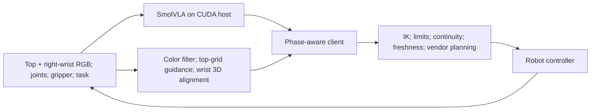

# Lumos Station Lite × SmolVLA

A practical integration of pretrained SmolVLA with Lumos Station Lite for prompt-guided, single-arm pick-and-place. The reference pipeline combines **35 local red-block demonstrations**, pretrained SmolVLA, calibrated visual alignment and a guarded robot client.

On **13 November 2026**, the operator reported successful pick-and-place in **8/8 documented trials**, including new target colors, 30°/45°/60° rotations, an intermediate grid position and two differently colored distractors. See [results and evidence limits](docs/RESULTS_NEW9_20261113.md).

The complete system demonstrated prompt-guided pick-and-place across multiple colors, object orientations, and scenes with differently colored distractors. SmolVLA operates alongside prompt color parsing, HSV filtering, top-grid guidance, calibrated wrist-camera alignment, and guarded execution.

## Documentation

| Task | Guide |
|---|---|
| Deploy the approved checkpoint | [Three-terminal quickstart](docs/QUICKSTART_STATION_LITE.md) |
| Reproduce data conversion and fine-tuning | [Training pipeline](docs/TRAINING_PIPELINE.md) |
| Understand the engineering decisions | [Best practices](docs/SMOLVLA_BEST_PRACTICES.md) |
| Prepare the software environment | [Environment reference](docs/ENVIRONMENT_REFERENCE.md) |
| Locate active and historical resources | [Resource map](docs/RESOURCE_MAP.md) |
| Describe the achievement accurately | [Results and attribution](docs/RESULTS_NEW9_20261113.md) |
| Prepare a project release | [Sharing and curated export](docs/SHARING.md) |

## Architecture



The reference uses a right7 **10,000-step** checkpoint. State is six right-joint angles plus measured gripper opening. Output is **absolute end-effector XYZ + Euler RPY + gripper opening**, not joint angles. Two physical cameras feed the policy; the saved config additionally contains a padded camera slot.

The host performs CUDA inference. The robot acquires observations and runs visual geometry, IK, guarded execution and logging. This baseline uses settled chunks and client alignment/smoothing; it is **not the historical Guided RTC experiment**.

## Reproduce the baseline

- Match source hashes in the [baseline manifest](releases/right7_20261113/BASELINE_MANIFEST.json) on both computers.
- Use the checkpoint's own processors/statistics and the separate VLM cache.
- Require CUDA for training/inference; stop if unavailable.
- Recalibrate a different robot, camera mounting, tool or tabletop before motion.
- Preserve raw data. The 10 fixed holdout episodes have already been inspected during diagnosis.
- SDK construction can enable motors; the normal client homes **both arms**. Software tests and health responses do not prove physical safety or placement success.

Weights, raw demonstrations, caches and the vendor SDK are supplied separately. A repository clone is not a complete robot installation. See the environment reference for known dependency gaps and the distinction between the observed environment and a newly validated installation.

## Prepare a release

From the directory containing `SmolVLA/`:

```bash
python SmolVLA/prepare_shared_repository.py --profile public --output /tmp/SmolVLA_release_20261113
```

The destination must be new. This exports source/docs plus checksums, without uploading or starting anything. [The file list](RELEASE_FILES.txt) excludes datasets, weights, images and caches.

Historical 14D/ACT comparisons and v0.7 experiments remain in the full project and are not the deployment recipe. The public export includes an English summary of the previous README in `docs/archive/README_before_student_pipeline_20261113.md`; maintainers use [HANDOFF.md](HANDOFF.md).
